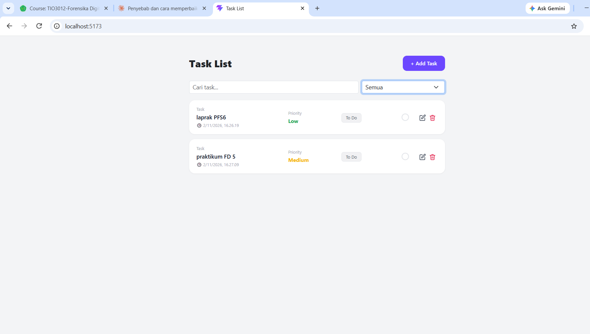
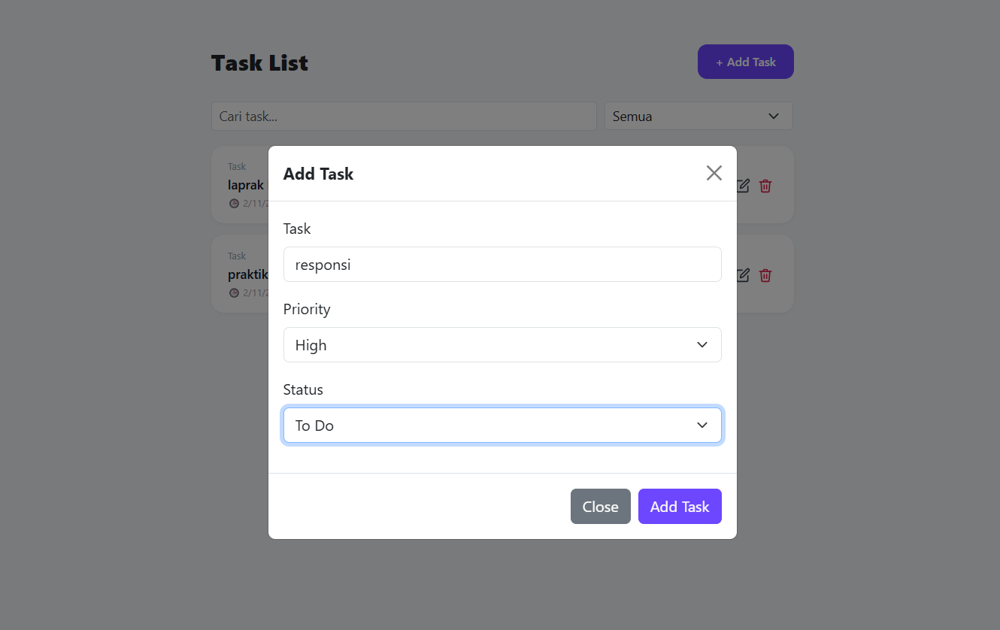

# TodoList React JS CRUD
Aplikasi TodoList sederhana dengan fitur Create, Read, Update, dan Delete (CRUD) menggunakan React JS dan Vite. Untuk file tugasnya bernama 
- TaskForm1.jsx
- TaskList1.jsx
- App1.jsx
- main1.jsx

- **Nama:** Yuli Andriani
- **NIM:** 2511501042
- **Kelas:** A2

## Fitur

- Tambah tugas
- Lihat daftar tugas
- Edit tugas
- Hapus tugas
- Filter tugas sesuai priority
- cari tugas

## Tampilan

### Halaman Utama

### Edit Tugas

## Teknologi
- React JS
- Vite
- CSS

## Cara Menjalankan
1. Clone repository ini
2. Jalankan `npm.cmd run dev` di terminal VSC
3. Buka alamat yang muncul di terminal (biasanya http://localhost:5173)